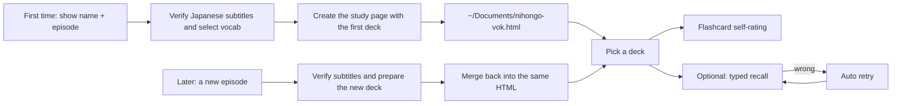

**[🇨🇳 中文](README.md)** · **English** · [🇯🇵 日本語](README.ja.md)

<div align="center">

# NihongoVok · 日剧词

### Turn Japanese TV, anime, film & podcast subtitles into an offline HTML flashcard deck.

Author: 疯狂的豇豆 · [www.crazyowen.cn](https://www.crazyowen.cn)

> The idiomatic phrases you pick up from a Japanese show or anime are often the most useful — and the hardest to memorize. Feed a Japanese series, anime, film, or podcast into **NihongoVok** and it extracts that episode's high-frequency words into an HTML flashcard deck you can open with a double-click: offline, no Anki, no network.

[Open the live demo (8 original Japanese sentences)](https://github.com/owenwuhaha/nihongo-vok/raw/refs/heads/main/examples/demo.html) · [Install](#install) · [Usage](#usage)


</div>

---

**In one line**: type “NihongoVok + show + episode” and it produces `~/Documents/nihongo-vok.html` — that episode's high-frequency practical Japanese words, each with kana reading, romaji, part of speech and grammar notes, plus Japanese TTS. Self-rated flashcards by default; switch to typed recall with auto-grading and retry. Each new episode merges back into the same file, so **one HTML file is your Japanese word bank**.

**Who it's for**: people studying Japanese through shows/anime/films/podcasts and wanting to build vocabulary along the way; JLPT (N5–N1) / J.TEST / NAT-TEST exam prep using real sentences; anyone who wants flashcards with **zero install, fully offline**.

**Why it's different**:

| What you get | Notes |
|---|---|
| **Authentic language** | Every card comes from real subtitles, not textbook lines |
| **Zero friction** | Double-click the HTML — no Anki, no server, no internet |
| **Japanese detail** | Kanji words show kana reading + romaji; parts of speech marked; set phrases / particle combos / suffixes in grammar notes |
| **Level-matched** | Defaults to JLPT N3–N2; give it your target level and it filters accordingly, with difficulty check-back |
| **Always available** | Offline TTS (`ja-JP`), wrong answers auto-requeued for retry |

> The demo uses 8 original Japanese sentences to show the features; it is not from any specific show.

## Japanese-specific features

- **Kanji with reading**: every word shows its kana reading (`reading`) and romaji, so you learn the kanji-to-pronunciation mapping.
- **Part of speech**: nouns/verbs/adjectives/particles/set-phrases are tagged with `pos`; verbs mark transitive/intransitive (自動詞/他動詞), ~te form, and keigo.
- **Grammar notes**: fixed collocations, particle usage, suffixes (e.g. `〜っぽい`, `〜気味`), and set phrases go into the card's `grammar` field.
- **Japanese TTS**: the page reads the original sentence with the device's Japanese voice (`ja-JP`).

## Learning flow



Each card carries the Japanese word (with reading), part of speech, contextual meaning, the original sentence and its translation. Flashcard self-rating is the default; typed recall hides the target in the sentence, checks your input and re-queues mistakes. Acceptable spelling/expression variants are listed explicitly in the deck (both the kanji form and the kana reading are recommended). Progress is saved per deck.

Japanese level sets the vocabulary range: default **JLPT N3–N2**. If you name an exam and level, NihongoVok prefers that exam's range — e.g. JLPT N5–N1, J.TEST, NAT-TEST. After generation the agent asks whether the words felt hard, right, or easy, and can shift the range up or down based on your feedback.

## Install

Clone this repo into the Skills directory of the target platform. Paths and activation per platform:

### Install to Codex

macOS / Linux:

```bash
git clone --depth 1 https://github.com/owenwuhaha/nihongo-vok.git ~/.codex/skills/nihongo-vok
```

### Install to WorkBuddy

User-level (all projects):

```bash
git clone --depth 1 https://github.com/owenwuhaha/nihongo-vok.git ~/.workbuddy/skills/nihongo-vok
```

Project-level (current workspace only, place under `<your-project>/.workbuddy/skills/`):

```bash
git clone --depth 1 https://github.com/owenwuhaha/nihongo-vok.git <your-project>/.workbuddy/skills/nihongo-vok
```

Restart WorkBuddy after cloning, or call `$nihongo-vok` directly in a conversation.

### Install to Doubao (豆包)

- **Doubao web/client (workbench)**: open "自定义技能 / Skills" → create a skill → paste the full content of `SKILL.md` into the skill content box → set the name "日剧词 / NihongoVok" and trigger words (e.g. "日剧词", "日语词汇") → save and enable.
- **Doubao TUI (CLI)**: place it in the global skills directory and restart the client:

```bash
git clone --depth 1 https://github.com/owenwuhaha/nihongo-vok.git ~/.doubao/skills/nihongo-vok
# or ~/.agents/skills/nihongo-vok
```

### Install to Hermes Agent

On [hermes.crazyowen.cn](https://hermes.crazyowen.cn), register or create an Agent (complete verification per the community flow), then paste the full content of `SKILL.md` into its "人设 / 指令" (persona / instructions) box. Set the name to "日剧词 / NihongoVok" and the description from SKILL.md's `description`. After saving, that Agent gains Japanese episode vocabulary extraction.

### Install to OpenClaw

Place it in the shared skills directory (applies to all agents on this machine), then restart the gateway:

```bash
git clone --depth 1 https://github.com/owenwuhaha/nihongo-vok.git ~/.openclaw/skills/nihongo-vok
openclaw gateway restart   # or a new session /new
openclaw skills list       # verify it loaded
```

Invoke with `/nihongo-vok` in chat, or just describe what you need in natural language.

---

If already installed, enter the skill directory and run `git pull` to update. After installing, use it in a new task like:

```text
Use $nihongo-vok to generate an HTML vocabulary study page for 静かな海のあいだに S01E01.
```

You can also hand the agent Japanese subtitles or a script directly. For other agents that support Skills, drop the whole repo into their personal Skills directory.

## Usage

By default up to 50 Japanese words per episode; when subtitles are thin, generate what is actually there instead of padding. Existing subtitles are used directly; once a reliable source is found, extraction starts without dragging the process out to collect more sources.

```text
Use 日剧词 to build the 静かな海のあいだに S01E01 deck and add it to my study page.
```

On first use the study page is saved at `~/Documents/nihongo-vok.html` and contains the first deck. Later, when you name a new episode, the agent merges the new deck back into the same file, delivers the updated HTML and tells you which episode was added — no manual JSON import. If that file is already open in your browser, reopen the updated file to see the new deck. If the agent cannot find or read your existing study page, it asks for the file or its path rather than building an empty page that overwrites your content.

Double-click `nihongo-vok.html` to study. The page needs no Anki, server, or network, and no Python. Flashcards self-rate by default; switch to "typed recall" in the page — that choice is saved in the current browser and applies to all decks. The HTML holds the whole library; copy it to back up the library. Progress and mode preference live in the browser and must be exported via the page's progress-backup feature. Local data may not follow automatically across browsers, devices, or file moves; a full migration needs both the HTML and the progress backup. Whether device voice works depends on the browser.

After each generation, watch for the agent's difficulty check-in. Reply "too hard" or "too easy" and name your exam and level (e.g. JLPT N2); the agent updates the same episode deck — no manual JSON import.

## Scope

- Japanese AV single episodes / podcast segments (jdrama, Japanese films, anime, Japanese news, Japanese podcasts).
- Subtitle sources and content must be verifiable to the named episode/show; when no reliable Japanese subtitles are found, the agent asks you for them rather than inventing lines.
- Only curated example sentences are saved; full episode subtitles are never bundled into the page.
- The page supports multi-deck selection and mistake retry; it does not yet offer day-spanning FSRS / Anki-style review scheduling.
- "Correct this round" means the input was right this time, not that it is permanently memorized.

## Manual generation

Validating the deck and merging into the study page needs Python 3's standard library; learners only need a browser.

```bash
python3 scripts/build_html.py examples/demo.json study.html
```

See [references/data-format.md](references/data-format.md) for the deck format. The page embeds the whole library in `vocab-library`; the delivered HTML needs no accompanying JSON or other files. Maintainers can still create the HTML from a single-episode JSON.

## Project structure

| Path | Purpose |
|---|---|
| `SKILL.md` | Agent trigger conditions and generation flow (Japanese-only) |
| `assets/study.html` | Reusable study-page template (reading/romaji/pos display, ja-JP TTS) |
| `scripts/build_html.py` | Validate cards and generate the study page |
| `references/` | Japanese subtitle sources and card format docs |
| `examples/demo.html` | Openable original Japanese demo |

## Maintainer verification

When the template or generator changes, run:

```bash
python3 -m unittest discover -s tests -p 'test_*.py'
npm install && npm test
```

Browser interaction tests use local Chrome and Playwright. Deck generation/merge tests and offline Chrome interaction tests cover default self-rating, mode switching, cross-deck preference, per-deck progress isolation, HTML merge update, legacy deck migration, and language/exam metadata. Device voice is not verified for audio quality.

## Source & license

Adapted from [pyang5166/gbro-series-vocab](https://github.com/pyang5166/gbro-series-vocab): Anki/Markdown delivery became a standalone HTML study page, with the learning language locked to Japanese (adding reading/romaji/pos/grammar fields and ja-JP TTS). Author: 疯狂的豇豆 ([www.crazyowen.cn](https://www.crazyowen.cn)); the upstream MIT license and the original author pyang5166 (狗哥笔记) copyright notice are retained. TypeWords' practice design is referenced only; no GPL-3.0 source is copied.
