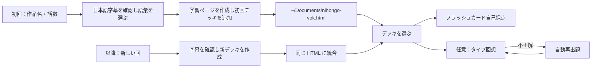

**[🇨🇳 中文](README.md)** · [🇺🇸 English](README.en.md) · **🇯🇵 日本語**

<div align="center">

# 日剧词（にちげきことば） · NihongoVok

### ドラマ・映画・アニメの本物の日本語字幕で、自然な日本語を学ぶ。

作者：疯狂的豇豆（狂った豇豆）· [www.crazyowen.cn](https://www.crazyowen.cn)

日本のドラマ・映画・アニメの作品名と話数を渡すと、その回の語彙を共通 HTML 学習ページに追加します。

[デモを開く](https://github.com/owenwuhaha/nihongo-vok/raw/refs/heads/main/examples/demo.html) · [Codex へ導入](#codex-へ導入) · [使い方](#使い方)


</div>

**日剧词（NihongoVok）** は、指定した回の本物の日本語字幕から実用的な表現を抜き出し、一つの共通 HTML 学習ページに追加します。初回は学習ページを作って最初のデッキを入れ、以降の回は同じファイルに統合されます。ページを開けばデッキを切り替えて学習できます。標準はフラッシュカードの自己採点で、中国語ヒントから日本語（漢字または仮名）を入力する「タイプ回想」にも切り替えられ、自動探点と再出題を行います。

> デモは機能を示すためのオリジナル日本語例文 8 件です。特定の作品ではありません。

## 日本語独自の機能

- **漢字に読みを併記**：単語には仮名読み（`reading`）とローマ字（`romaji`）を表示し、漢字と発音の対応を覚えられます。
- **品詞タグ**：名詞／動詞／形容詞／助詞／慣用句などに `pos` を付け、動詞は自他（自動詞／他動詞）、て形、敬語を明示します。
- **文法メモ**：決まり文句、助詞の使い分け、接辞（「〜っぽい」「〜気味」など）、慣用句をカードの `grammar` 欄に書きます。
- **日本語読み上げ**：ページは端末の日本語音声（`ja-JP`）で原文を読み上げます。

## 学習の流れ



各カードには、日本語単語（読み付き）、品詞、文脈の意味、原文、訳が入ります。標準はフラッシュカード自己採点。タイプ回想は文中のターゲットを隠し、入力を採点して誤答を再キューします。許容される表記・表現のゆれはデッキに明示されます（漢字形と仮名読みの両方を推奨）。進捗はデッキごとに保存されます。

日本語の級で語彙範囲を決めます。標準は **JLPT N3–N2**。試験と級を指定すると、その試験範囲（JLPT N5–N1、J.TEST、NAT-TEST など）を優先します。生成後、エージェントは単語が難しすぎたか・ちょうどか・簡単すぎたかを尋ね、フィードバックに応じて範囲を上下に調整します。

## 導入

このリポジトリを各プラットフォームの Skills ディレクトリにクローンします。プラットフォームごとのパスと有効化方法：

### Codex へ導入

macOS / Linux：

```bash
git clone --depth 1 https://github.com/owenwuhaha/nihongo-vok.git ~/.codex/skills/nihongo-vok
```

### WorkBuddy へ導入

ユーザーレベル（すべてのプロジェクトに適用）：

```bash
git clone --depth 1 https://github.com/owenwuhaha/nihongo-vok.git ~/.workbuddy/skills/nihongo-vok
```

プロジェクトレベル（現在のワークスペースのみ、`<プロジェクト>/.workbuddy/skills/` に配置）：

```bash
git clone --depth 1 https://github.com/owenwuhaha/nihongo-vok.git <プロジェクト>/.workbuddy/skills/nihongo-vok
```

クローン後 WorkBuddy を再起動するか、会話で `$nihongo-vok` を直接呼び出します。

### 豆包（Doubao）へ導入

- **豆包ウェブ／クライアント（ワークベンチ）**：「自定义技能 / 技能管理」→ スキルを新規作成 → 本リポジトリの `SKILL.md` 全文を貼り付け → 名前「日剧词 / NihongoVok」とトリガー語（「日剧词」「日语词汇」など）を設定 → 保存して有効化。
- **Doubao TUI（CLI）**：グローバル Skills ディレクトリに置き、クライアントを再起動：

```bash
git clone --depth 1 https://github.com/owenwuhaha/nihongo-vok.git ~/.doubao/skills/nihongo-vok
# または ~/.agents/skills/nihongo-vok
```

### Hermes Agent へ導入

[hermes.crazyowen.cn](https://hermes.crazyowen.cn) で Agent を登録／作成（コミュニティの流れで認証）し、その「人设 / 指令」（ペルソナ／指示）欄に本リポジトリの `SKILL.md` 全文を貼り付けます。名前を「日剧词 / NihongoVok」、説明を SKILL.md の `description` から設定。保存するとその Agent は日本語ドラマ語彙抽出能力を持ちます。

### OpenClaw へ導入

共有 Skills ディレクトリに置き（このマシンの全 Agent に適用）、ゲートウェイを再起動：

```bash
git clone --depth 1 https://github.com/owenwuhaha/nihongo-vok.git ~/.openclaw/skills/nihongo-vok
openclaw gateway restart   # または新しいセッション /new
openclaw skills list       # 読み込みを確認
```

呼び出し：チャットで `/nihongo-vok`、または自然言語で要件を伝えます。

---

すでに導入済みなら、スキルディレクトリで `git pull` して更新します。導入後は新しいタスクで次のように使います：

```text
$nihongo-vok を使って、静かな海のあいだに S01E01 の HTML 語彙学習ページを作って。
```

日本語字幕や台本をそのままエージェントに渡しても構いません。Skills に対応する他の Agent には、リポジトリ全体をその Skills ディレクトリに入れます。

## 使い方

標準は1回あたり最大 50 語。字幕が薄い場合は、水増しせず実際にある分だけ生成します。既存字幕はそのまま使い、信頼できるソースが得られしだい抽出を開始し、複数ソースを集めるために処理を長引かせることはありません。

```text
日剧词で『静かな海のあいだに』S01E01 のデッキを作り、学習ページに追加して。
```

初回は学習ページを `~/Documents/nihongo-vok.html` に保存し、最初のデッキを含めます。以降、新しい回を指定するとエージェントは新デッキを同じファイルに統合し、更新後の HTML を渡してどの回を追加したかを説明します（JSON の手動インポートは不要）。そのファイルがブラウザで開いていれば、更新後のファイルを再び開くと新デッキが表示されます。既存の学習ページが見つからない／読めない場合、エージェントは空ページを作って上書きするのではなく、ファイルかそのパスを求めます。

`nihongo-vok.html` をダブルクリックで学習。Anki・サーバー・ネット・Python は不要です。標準はフラッシュカード自己採点。ページ内で「タイプ回想」に切り替えられ、その選択は現在のブラウザに保存され全デッキに適用されます。HTML は語彙ライブラリ全体を保持し、コピーすればバックアップに。進捗とモード設定はブラウザに保存され、ページの進捗バックアップ機能で別途書き出す必要があります。ブラウザ・デバイス・ファイル移動をまたいでローカルデータが自動追従するとは限らず、完全な移行には HTML と進捗バックアップの両方が必要です。端末音声はブラウザ次第です。

生成ごとにエージェントの難易度確認に留意してください。「難しすぎた」「簡単すぎた」と答え、受ける試験と級（JLPT N2 など）を伝えると、エージェントは同じ回のデッキを更新します（JSON の手動インポートは不要）。

## 対象範囲

- 日本語映像の単回／ポッドキャスト区分（ドラマ、日本映画、アニメ、日本語ニュース、日本語ポッドキャスト）。
- 字幕ソースと内容は指定した回／番組に照合可能でなければならない。信頼できる日本語字幕が見つからない場合、エージェントは作らずに字幕を求める。
- 厳選した例文のみ保存し、回全体の字幕をページに同梱しない。
- ページは複数デッキ選択と誤答再出題に対応。日をまたぐ FSRS／Anki 式の復習スケジュールは現在未対応。
- 「今回正解」はその回の入力が正しかったことを意味し、長期記憶を保証するものではない。

## 手動生成

デッキ検証と学習ページへの統合には Python 3 標準ライブラリが必要。学習者はブラウザのみ。

```bash
python3 scripts/build_html.py examples/demo.json study.html
```

デッキ形式は [references/data-format.md](references/data-format.md) を参照。ページは全体ライブラリを `vocab-library` に埋め込む。納品する HTML に JSON 等の同伴は不要。メンテナは単回 JSON から HTML を作成できます。

## プロジェクト構成

| パス | 用途 |
|---|---|
| `SKILL.md` | Agent のトリガー条件と生成フロー（日本語専用） |
| `assets/study.html` | 共通学習ページテンプレート（読み／ローマ字／品詞表示、ja-JP 読み上げ） |
| `scripts/build_html.py` | カード検証と学習ページ生成 |
| `references/` | 日本語字幕ソースとカード形式の説明 |
| `examples/demo.html` | そのまま開けるオリジナル日本語デモ |

## メンテナ検証

テンプレートや生成器を変更した際は実行：

```bash
python3 -m unittest discover -s tests -p 'test_*.py'
npm install && npm test
```

ブラウザ対話テストはローカル Chrome と Playwright 使用。デッキ生成／統合テストと Chrome オフライン対話テストは、標準自己採点、モード切替、デッキ間設定、デッキごと進捗分離、HTML 統合更新、旧デッキ移行、言語／試験メタデータをカバー。端末音声の聴感は未検証。

## 出典とライセンス

本作は [pyang5166/gbro-series-vocab](https://github.com/pyang5166/gbro-series-vocab) を改変したもの。Anki／Markdown 納品を独立 HTML 学習ページに変え、学習言語を日本語に固定（読み／ローマ字／品詞／文法メモ欄と ja-JP 読み上げを追加）。作者：疯狂的豇豆（[www.crazyowen.cn](https://www.crazyowen.cn)）。上流の MIT ライセンスと原作者 pyang5166（狗哥笔记）の著作権表示を保持。TypeWords の練習設計は参考のみで、GPL-3.0 ソースはコピーしていない。
