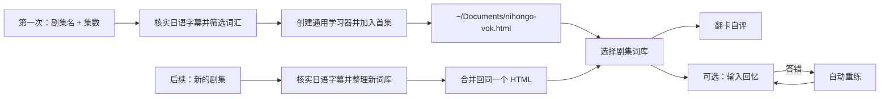

**🇨🇳 中文** · [🇺🇸 English](README.en.md) · [🇯🇵 日本語](README.ja.md)

<div align="center">

# 日剧词 · NihongoVok

### 看日剧 / 日影 / 动画学地道日语，一键生成一个能离线刷的 HTML 单词卡学习器。

作者：疯狂的豇豆 · [www.crazyowen.cn](https://www.crazyowen.cn)

> 看日剧、动画时学到的地道表达，往往最实用也最难背。把一部日剧/动画/电影/播客的日语字幕丢给**日剧词**，它会把那一集的高频实用词抽出来，变成一个 HTML 单词卡学习器——**双击就能开刷**，离线可用、不用装 Anki、不用联网。

[在线体验示例页（8 个原创日语句）](https://github.com/owenwuhaha/nihongo-vok/raw/refs/heads/main/examples/demo.html) · [安装方式](#安装) · [使用](#使用)


</div>

---

**一句话**：输入「日剧词 + 剧名集数」，输出一个 `~/Documents/nihongo-vok.html`——把这一集的高频实用日语词抽出来，附假名读音、罗马字、品詞、语法备注，并支持日语朗读；默认翻卡自评，也可切成「输入回忆」自动判题错词重练。以后每看一集，新词自动合并回同一文件，**一个 HTML 文件就是你的日语词库**。

**适合谁**：正在看日剧 / 日影 / 动画 / 日语播客并想顺带积累词汇的人；备考 JLPT（N5–N1）/ J.TEST / NAT-TEST 想用真题句练词的人；希望**完全离线、不装任何软件**就能刷单词的人。

**优势**：

| 你拿到的 | 说明 |
|---|---|
| **地道语感** | 词库全部来自真实日剧/动画/播客，而非教科书例句 |
| **零门槛** | 双击 HTML 即用，不装 Anki、不联网、不需服务器 |
| **日语细节全** | 每个汉字词都带假名读音 + 罗马字，名词/动词/助词标品詞，惯用句/助词搭配/接辞写入语法备注 |
| **按你的等级筛词** | 默认 JLPT N3–N2，说明目标级别后会按对应范围筛选，并可难度回访上下调 |
| **随时可用** | 离线朗读（设备 `ja-JP` 语音），错词自动排回队列重练 |

> 示例页使用 8 个原创日语句子演示功能，不来自任何剧集。

## 日语专属能力

- **汉字带读音**：每条词显示假名读音（reading）与罗马字（romaji），帮你记住汉字与发音的对应。
- **品詞标注**：名词/动词/形容词/助词/慣用句等标出品詞（pos），动词区分自他（自動詞/他動詞）、て形、敬语。
- **语法备注**：固定搭配、助词用法、接辞（如「〜っぽい」「〜気味」）、惯用句等写到卡片 `grammar` 字段。
- **日语朗读**：页面用设备日语语音（`ja-JP`）朗读原句。

## 学习流程



每条词汇卡包括日语词（含读音）、品词、语境释义、原句和译文。翻卡自评是默认方式；输入回忆会隐藏原句中的目标表达，检查输入并安排错词重练。可接受的拼写或表达变体由词库明确列出（建议同时收“汉字词”和“假名读音”）。每个剧集词库独立保存练习进度。

日语分级决定词汇范围：默认 JLPT N3–N2；如果用户说明考试和级别，会优先按对应考试范围筛选，例如 JLPT N5–N1、J.TEST、NAT-TEST。生成后 Agent 会询问词汇是偏难、合适还是偏简单，并可按反馈把范围下调或上调。

## 安装

把本仓库克隆到对应平台的 Skills 目录即可。各平台路径与激活方式如下。

### 安装到 Codex

macOS / Linux：

```bash
git clone --depth 1 https://github.com/owenwuhaha/nihongo-vok.git ~/.codex/skills/nihongo-vok
```

### 安装到 WorkBuddy

用户级（对所有项目生效）：

```bash
git clone --depth 1 https://github.com/owenwuhaha/nihongo-vok.git ~/.workbuddy/skills/nihongo-vok
```

项目级（仅当前工作区，放入项目 `.workbuddy/skills/`）：

```bash
git clone --depth 1 https://github.com/owenwuhaha/nihongo-vok.git <你的项目>/.workbuddy/skills/nihongo-vok
```

克隆后重启 WorkBuddy，或在对话中直接调用 `$nihongo-vok`。

### 安装到 豆包

- **豆包网页版 / 客户端（工作台）**：打开「自定义技能 / 技能管理」→ 新建技能 → 把本仓库 `SKILL.md` 的全部内容粘贴到技能内容区 → 填写名称「日剧词 / NihongoVok」与触发词（如「日剧词」「日语词汇」）→ 保存并启用。
- **Doubao TUI（命令行版）**：放入全局技能目录后重启客户端即可：

```bash
git clone --depth 1 https://github.com/owenwuhaha/nihongo-vok.git ~/.doubao/skills/nihongo-vok
# 或 ~/.agents/skills/nihongo-vok
```

### 安装到 Hermes Agent

在 [hermes.crazyowen.cn](https://hermes.crazyowen.cn) 注册或创建一个 Agent（按社区流程完成验证），在其「人设 / 指令」区把本仓库 `SKILL.md` 的内容粘贴进去，名称设为「日剧词 / NihongoVok」、描述取自 SKILL.md 的 `description`。保存后该 Agent 即具备日语剧集词汇提取能力。

### 安装到 OpenClaw

放入共享技能目录（对当前机器所有 Agent 生效），然后重启网关：

```bash
git clone --depth 1 https://github.com/owenwuhaha/nihongo-vok.git ~/.openclaw/skills/nihongo-vok
openclaw gateway restart   # 或新开会话 /new
openclaw skills list       # 验证已加载
```

调用：在对话中输入 `/nihongo-vok`，或直接用自然语言描述需求。

---

如果已安装，进入技能目录执行 `git pull` 更新。安装后在新任务里这样使用：

```text
使用 $nihongo-vok，为我生成 静かな海のあいだに S01E01 的 HTML 词汇学习页。
```

也可以直接把日语字幕或剧本文字提供给 Agent。其他支持 Skills 的 Agent，将整个仓库放入它的个人 Skills 目录即可。

## 使用

默认每集整理最多 50 条日语词汇，字幕材料不足时按实际内容生成，不凑数量。已有字幕会直接使用；拿到一份可靠来源后就开始整理，不会为了收集多份来源而延长流程。

```text
用日剧词生成《静かな海のあいだに》S01E01 词库，加入我的学习器。
```

首次使用时，学习器保存在 `~/Documents/nihongo-vok.html` 并包含首集词库。以后提出新剧集，Agent 会把新词库自动合并回同一个文件，交付更新后的 HTML 并说明已加入哪一集；你不需要手动导入 JSON。如果这个文件已经在浏览器打开，重新打开更新后的文件即可看到新词库。若 Agent 找不到已有学习器或无法读取它，会向你索要原文件路径或文件，不会另建一个空库覆盖原有内容。

双击 `nihongo-vok.html` 即可学习。网页不依赖 Anki、服务器或网络；无需安装 Python。页面默认使用翻卡自评，可在页面中切换“输入回忆”；这个选择会保存在当前浏览器并应用于所有词库。HTML 文件包含整套词库，复制它即可备份词库；练习进度和模式偏好保存在浏览器，需要用页面的进度备份功能另行导出。换浏览器、设备或移动文件时，本地数据不保证自动跟随，完整迁移需要带上 HTML 和进度备份。设备语音是否可用取决于浏览器。

每次生成后请留意 Agent 的难度回访。回复“太难”或“太简单”，并告诉它你要考的考试和级别（如 JLPT N2），Agent 会更新同一剧集词库；不需要手动导入 JSON。

## 适用范围

- 面向日语影视单集/播客段落词汇学习（日剧、日本电影、动画、日语新闻、日语播客）。
- 字幕来源和内容必须能核实到指定剧集/节目；找不到可靠日语字幕时，Agent 会请你提供字幕，不会凭记忆造台词。
- 只保存精选学习例句，不把整集字幕打包进网页。
- 网页支持多剧集词库选择与错词重练；目前不提供跨天的 FSRS / Anki 式复习排程。
- “本轮答对”表示这次输入正确，不代表已经长期记住。

## 手动生成

需要 Python 3 的标准库来校验词库并合并到通用学习器；学习者只需浏览器。

```bash
python3 scripts/build_html.py examples/demo.json study.html
```

词库数据格式见 [references/data-format.md](references/data-format.md)。页面使用 `vocab-library` 内嵌整个词库集合；交付的 HTML 不需要 JSON 或其他文件伴随。维护者手动生成演示页时仍可从单集 JSON 创建 HTML。

## 项目结构

| 路径 | 用途 |
|---|---|
| `SKILL.md` | Agent 的触发条件与生成流程（日语专用） |
| `assets/study.html` | 通用学习器模板（含读音/罗马字/品詞显示、ja-JP 朗读） |
| `scripts/build_html.py` | 校验词条并生成学习页 |
| `references/` | 日语字幕来源与词条格式说明 |
| `examples/demo.html` | 可直接打开的原创日语示例 |

## 维护者验证

模板或生成器改动时，可以运行：

```bash
python3 -m unittest discover -s tests -p 'test_*.py'
npm install && npm test
```

浏览器交互测试使用本机 Chrome 和 Playwright。已运行词库生成/合并测试和 Chrome 离线交互测试，覆盖默认自评、输入模式切换、跨词库偏好、每集进度隔离、HTML 合并更新、旧单词库迁移和语言/考试元数据。设备语音没有做听感验证。

## 来源与许可

本项目由 [pyang5166/gbro-series-vocab](https://github.com/pyang5166/gbro-series-vocab) 改编，将 Anki/Markdown 交付改为独立 HTML 学习页，并把学习语言锁定为日语（新增读音/罗马字/品詞/语法备注与 ja-JP 朗读）。作者：疯狂的豇豆（[www.crazyowen.cn](https://www.crazyowen.cn)），保留上游 MIT 许可与原作者 pyang5166（狗哥笔记）的版权声明。TypeWords 的练习设计仅作参考，本仓库没有复制其 GPL-3.0 源代码。
